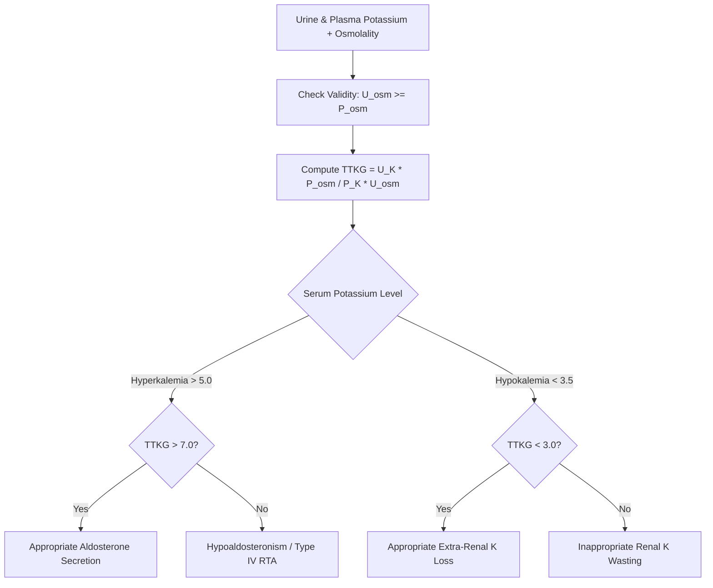

# Renal Transtubular Potassium Gradient (TTKG) Skill

[](LICENSE)
[](https://www.python.org/)
[](https://openclaw.org/)
[](https://alphapark.ai/)
[](https://modelcontextprotocol.io/)

Renal Transtubular Potassium Gradient (TTKG) and Distal Tubular Secretion Evaluator based on nephrological electrolyte physiology.



## Features
- **Zero PIP Dependencies**: Implemented strictly with Python Standard Library (`math`, `json`, `sys`, `typing`).
- **Physiological Verification**: Automatically validates urine-to-plasma osmolality ratio and distal sodium delivery conditions.
- **Electrolyte Precision**: Rigorous algorithmic discrimination between mineralocorticoid deficiency, excess, and extra-renal losses.
- **Dual Architecture**: Native Python import and Model Context Protocol (MCP) JSON-RPC 2.0 stdio server.

## Quickstart
```bash
python example_usage.py
```

## License
Apache-2.0
